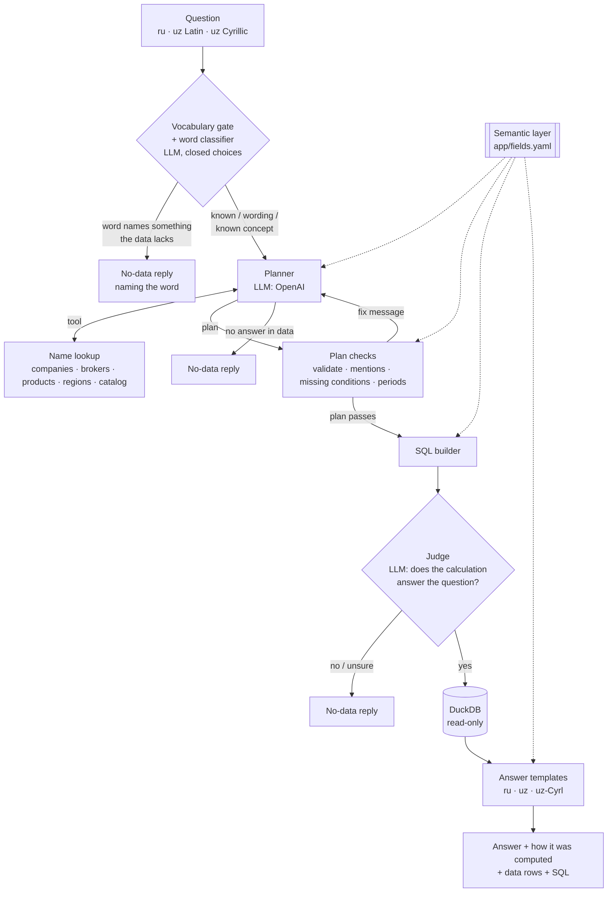
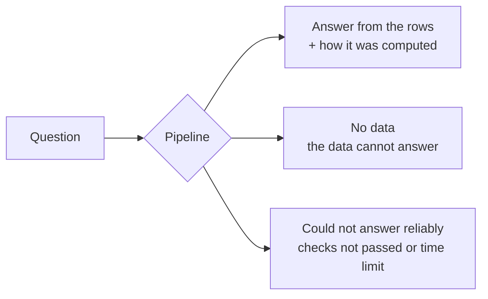

# Exchange Q&A agent

Answers Russian and Uzbek (Latin and Cyrillic) questions about the exchange deal registry in `data/`. Every
fact in an answer comes from the database result; if the data has no answer, the service says so. The data is fictional:
companies, tax IDs, brokers, contracts, deals and prices are invented (see `data/README.md`).

Live at **https://qa.contentcoach.org** (see `docs/deploy.md`).

**Latest evaluation** — fresh question set 4, written independently by a separate writer that never saw the
system, 60 intents × 3 languages, OpenAI `gpt-5.4-mini`, run once, never tuned on:

| | Result |
|---|---|
| Questions with no answer in the data, refused | **45 / 45** (and 0 of 324 answered across every set we have) |
| Answerable questions answered right | 93 / 135 (69%) |
| Answered wrongly (a real number, a slightly different question) | 6 (4%) |
| Refused although answerable | 36 (27%) |
| Russian / Uzbek Latin / Uzbek Cyrillic answered right | 32 / 31 / 30 of 45 |
| Invented numbers, names or dates | 0 by construction (answers are built from result rows) |
| Median / slowest response | 4.1 s / 10.3 s (limit 90 s); about $0.001 per question |

The system is tuned to refuse rather than guess: refusals name the unknown word and are logged, so the
vocabulary can grow from real use.

## Architecture

The core idea: **the language model never decides the facts and never writes the answer.** It does one
language job: it reads the question and fills in a small query plan. Everything else (finding IDs, checking
the plan, building SQL, running it, writing the answer) is deterministic code driven by one file, the
semantic layer.



Models run in three places, each with a narrow job: the word classifier (labels unknown words from a closed
list), the planner (fills the plan) and the judge (yes/no on the finished calculation). None of them writes
answer text, and every refusal path is code. The semantic layer (dotted lines) is read by every step: the
planner sees it in its prompt, the checks validate against it, the builder turns it into SQL, and the
templates take their labels and units from it.

### The semantic layer

`app/fields.yaml` describes the data once, as business concepts rather than columns:

| It declares | Example |
|---|---|
| **Subjects** and their tables / joins | deals, contracts, companies, brokers, usd_rates |
| **Fields** with type, SQL, labels in ru and uz, grounding | `product` → `d.product_canonical`, must come from name lookup |
| **Measures** defined once | `price_per_kg` = total amount ÷ total volume (weighted), `share`, `cancelled_share`, `days_to_payment` |
| **Time grains** | year, quarter, month, day, hour, per subject |
| **Records** and the columns a lookup lists | one deal: date, product, seller, buyer, payment and delivery dates, brokers, … |
| **Business rules** | money in so'm, USD at the deal-date rate; annulled deals excluded from rankings and shown separately in counts |
| **Data range** | deals 03.01.2022–30.10.2026; rates to 31.10.2026 |

Adding a capability is adding a line here, not new code: counts, totals, rankings, trends, shares, comparisons
and lookups for every subject come from the same builder.

### The plan

The planner fills the same small shape for every question:

```json
{"subject": "deals",
 "measures": [{"agg": "sum", "of": "tonnes"}],
 "filters":  [{"field": "product", "op": "=", "value": "Хлопок-сырец"},
              {"field": "year", "op": "between", "value": [2022, 2026]}],
 "group_by": ["buyer"], "order": "desc", "limit": 3,
 "mentions": [{"text": "хлопка-сырца", "used_as": "filter:product"}, {"text": "топ-3", "used_as": "limit"}]}
```

`compare` (two years, months, quarters or days, with the change) is the only other part. `mentions` copies
each phrase of the question the plan relies on and says what it sets.

### The components

| Step | What it does | Code |
|---|---|---|
| Data build | Loads the CSVs once into DuckDB with real types and ready-made columns: tonnes, sums in so'm and USD at the deal-date rate, a "cancelled" flag, one standard name per product (230 spellings → 42 products). | `app/ingest/` |
| Semantic layer | Subjects, fields, measures, labels, business rules (above). | `app/fields.yaml`, `app/plan/dictionary.py` |
| Name lookup | Turns "Pudexiz Plast", "paxta", "Самаркандская область", "BK001" or "экспортных" into the exact IDs and values in the data, across Cyrillic/Latin and Russian/Uzbek. A name that matches nothing returns nothing. | `app/resolve.py` |
| Planner | An LLM with one lookup tool fills the plan, guided by ~20 short examples. It can also say "the data can't answer this". | `app/agent/grammar_writer.py`, `app/plan/prompt.py`, `app/plan/examples.yaml` |
| Plan checks | Reject a plan that does not match the question, with a fix message back to the planner (bounded by the time budget). See the list below. | `app/plan/validate.py`, `checks.py`, `mentions.py` |
| SQL builder | One generic builder: plan + semantic layer → SQL. Tested against hand-written SQL. | `app/plan/build.py` |
| Explanation | One sentence saying exactly what was computed, from the plan and the labels. | `app/plan/explain.py` |
| Answer templates | The answer text, built from the result rows and labels in Russian, Uzbek Latin and Uzbek Cyrillic. No model writes answer text. | `app/answer/plan_templates.py` |
| Pipeline and API | Runs the steps under a time budget and serves `POST /ask` plus a chat page. | `app/pipeline.py`, `app/api.py` |

### One question, step by step

*"Сколько сделок было заключено в октябре 2025 года?"*

1. The planner fills the plan: subject deals, count, year 2025, month 10, with the mentions "октябре" and
   "2025".
2. The checks pass: the month and year in the question are in the plan, every value is grounded.
3. The builder returns both readings at once: all deals (17 808) and deals without annulled ones (16 620).
4. The template writes: "число сделок: 17 808 (без аннулированных: 16 620)".
5. The code appends: "Расчёт: сделки; за 10.2025; число сделок; все сделки и отдельно без аннулированных."

### What the user can get back



There is no other outcome: model-written text never reaches the user.

## Design decisions

### Why a plan instead of letting the model write SQL

A wrong SQL query gives a wrong number, and nothing downstream can catch it, because the wrong number really
is in the rows. So the model only says *what* to compute, in a shape small enough for code to check against
the question, and tested code decides *how*. The old free-SQL path remains only in the legacy planner
(`PLANNER=legacy`).

### How ambiguous questions are handled

Some questions hide a choice. The semantic layer's rules compute the usual readings together and the
explanation sentence states which one was used:

| Ambiguity | Example | What the answer shows |
|---|---|---|
| Deal status | "Сколько сделок…" | All deals and, separately, without annulled ones |
| Role | "Кто больше всех торговал?" | Buyers and sellers ranked separately |
| Currency | "Общая сумма…" | So'm by default; USD at the deal-date rate when asked |
| Average price | "Средняя цена…" | Weighted (amount ÷ volume) and the mean of single deals |
| Broker side | "Сколько сделок у брокера…" | A deal counted once, whichever side the broker was on |

Rankings exclude annulled deals, because those deals did not take place; a breakdown by status keeps them.

### How wrong answers are blocked

Each layer closes a different hole:

1. **Nothing is invented.** Answers are templates filled only with result-row values; the model writes no
   answer text.
2. **Names → IDs.** Filters may only use values returned by the name lookup or written in the question, and
   the ID must exist. "Брокер BK999" gets "no data", not "0 deals".
3. **The plan must match the question** (code, not the model, decides):
   - every product, company, number, year, date and catalog value in the question must be covered by a
     mention linked to the plan;
   - a named day must be that day, a named month or year must be inside the plan's period;
   - "по годам", "oylar bo'yicha" need one row per period; "least" needs ascending order; "how many
     different" needs a distinct count; a share word needs a share measure; "weighted" needs the weighted price;
   - conditions such as "export", a product grade or a category must be in the plan.
4. **Plain refusals.** Dates outside the data, unknown IDs (and an ID of the wrong kind: a deal number is never
   read as a contract), facts outside the exchange.
5. **Maximum safety (default, `UZEX_SAFETY=max`): refuse unless every layer agrees.**
   - **Closed vocabulary.** Every word of the question must be known: a semantic-layer term, a function word, a
     number or date, or a word of a name in the database (Russian words via their lemma, pymorphy3).
   - **Word classifier** for the words that are not: one LLM call labels each word with exactly one choice —
     "wording" (a verb, command, adverb: «ayting», «реально»), one concept the data has (from a fixed list
     built from the semantic layer: «yetakchi» → top, «qism» → share), or "other". Mapping by kind is
     forbidden (euro is a currency like the dollar → "other"). "other", no verdict or an error → refuse before
     planning; a mapped concept must actually be used by the plan.
   - **Judge on every answer:** a second LLM call reads the question and the deterministic calculation
     sentence and must confirm the calculation covers everything asked; no verdict → refuse.
   - Free SQL is off; the model can only fill the checked plan.
   `UZEX_SAFETY=balanced` keeps the earlier behaviour (judge only for unknown words, free SQL allowed).

### Time budget

The hard deadline is 75 s, under the 90 s requirement. Each LLM call is capped at 15 s, and a call only
starts if a full 15 s still fits before its deadline, so the worst case stays near 75 s. In practice most
answers take 2–5 s. A fallback to the next LLM provider (below) counts against the same deadline: it only
starts if a full 15 s still fits.

### LLM providers and fallback

Every model runs the same pipeline (same planner, tools, checks and code-rendered answers); only the
connection differs. Providers are named and tried in the order of `LLM_PROVIDERS`:

```
LLM_PROVIDERS=openai              # default
LLM_PROVIDERS=qwen_local,openai   # free local model first, the paid one only when it fails
LLM_PROVIDERS=qwen_local          # local only
```

Only OpenAI models (and OpenAI-compatible servers) are supported; Gemini support was removed. Built-in names:
`openai` and `qwen_local` (Ollama at `http://localhost:11434/v1`, model
`qwen2.5-7b-uzex`, temperature 0, tool calls through the prompt). Any other OpenAI-compatible server (vLLM,
llama.cpp, another cloud) gets a name of its own through `<NAME>_TYPE=openai`, `<NAME>_BASE_URL`,
`<NAME>_MODEL`, `<NAME>_API_KEY`, `<NAME>_TEMPERATURE`, `<NAME>_TEXT_TOOLS`; the same variables override the
built-in ones (e.g. `QWEN_LOCAL_MODEL`). A provider is used when it has an API key or a base URL.

If a call fails because of the provider (no credits, bad key, rate limit, server error, connection error, a
blocked/empty reply, or a timeout that still leaves time for another call), the same step is sent to the next
provider in the chain, also in the middle of a planning conversation: the conversation so far (tool calls and
their results) is replayed there, and it continues from there; it never returns to a provider it left. After a
"no credits" / bad-key / forbidden error (HTTP 402, 401, 403) the failing provider is skipped for 5 minutes.
Errors in our own code are never treated as a provider failure. Each answer's `providers_used` shows which
provider wrote each reply; the evaluation takes `--providers` to measure one provider or a chain.

## Project layout

```
app/
  fields.yaml   semantic layer: subjects, fields, measures, labels, business rules
  plan/         plan model, validation, checks, mention check, SQL builder, explanation, planner prompt;
                vocab.py (closed vocabulary), wordkind.py (word types), wordclass.py (word classifier), judge.py
  vocab.yaml    function and domain words of the closed vocabulary
  agent/        LLM providers with fallback, grammar planner (grammar_writer.py), legacy planner
  answer/       answer templates (plan_templates.py), fixed replies, legacy answer writer and checker
  ingest/       CSV → DuckDB build, product dictionary
  compiler/     legacy structured form and SQL templates (PLANNER=legacy)
  resolve.py    name lookup
  pipeline.py   the full question → answer flow
  api.py        HTTP API; static/ holds the chat page
data/                 source CSVs (fictional)
data_dictionary/      product and region dictionaries
eval/real/            evaluation: intents.yaml (dev/test), fresh*_intents.yaml (independently written sets,
                      each scored once), paraphrase sets, runner (--intents, --pick, --max-cost)
eval/                 older evaluation sets and runner
tests/                unit tests (offline) and live tests
docs/                 eval design, grammar redesign
```

## Run locally

```bash
uv sync
uv run python -m app.ingest.build
OPENAI_API_KEY=... uv run uvicorn app.api:app --port 8000
```

Keys can also go into a `.env` file in the project root (`KEY=value` lines; not committed). Variables already
set in the environment win.

Open http://localhost:8000 or call the API:

```bash
curl -s localhost:8000/ask -H 'Content-Type: application/json' -d '{"question": "Сколько сделок было в октябре 2025 года?"}'
```

## Run with Docker

```bash
docker build -t uzex-qa .
docker run -p 8000:8000 -e OPENAI_API_KEY=... uzex-qa
```

## Tests and evaluation

```bash
uv run pytest
uv run python -m eval.real.run --split dev --providers qwen_local             # free, local model
uv run python -m eval.real.run --split dev --providers openai --max-cost 0.40  # paid, stops at the budget
```

`eval.real.run` scores each phrasing as right, wrong, refused, or (for questions with no answer) correctly
refused, broken down by language, subject and question shape. It reports the tokens used and the estimated cost,
and stops starting new questions at `--max-cost`. `--pick file` runs exact phrasings; `--rescore file`
re-scores saved answers without calling a model. The test split is scored once, never tuned on. See
`docs/eval-design.md`.

## First live run

The tests run offline. Before relying on the service, check it against the real model:

1. `OPENAI_API_KEY=... uv run pytest -m live` (the live round-trip tests; skipped without a key).
2. Start the server and send one question to `/ask`, for example
   `curl -s localhost:8000/ask -H 'content-type: application/json' -d '{"question":"Сколько сделок было в 2025 году?"}'`.
3. Confirm that the model named in `OPENAI_MODEL` is available for your key (a 404 / "model not found" error
   means it is not); change `OPENAI_MODEL` if needed.
4. Then run the full evaluation (`eval.run`); it exits non-zero on any hallucination.

## Settings

| Env | Default | Meaning |
|---|---|---|
| `OPENAI_API_KEY` | none | OpenAI key (required unless only a local provider such as `qwen_local` is used) |
| `OPENAI_MODEL` | `gpt-5.4-mini` | planner model; verify the name is available for your account |
| `OPENAI_REASONING_EFFORT` | empty | sent as `reasoning_effort` to OpenAI; empty = not sent. `gpt-5.4-mini` rejects it together with function tools on Chat Completions, so leave it empty unless your model supports it |
| `LLM_PROVIDERS` | `openai` | named providers in fallback order (`openai`, `qwen_local`, or your own OpenAI-compatible server via `<NAME>_TYPE=openai`) |
| `OPENAI_TEMPERATURE` | `0` | planner temperature; 0 keeps plans consistent for the same question; empty = not sent |
| `OPENAI_TEXT_TOOLS` | off | `1`: tool calls through the prompt instead of the API tools field (for local servers) |
| `PLANNER` | `grammar` | `grammar` (plan + semantic layer) or `legacy` (old structured form) |
| `UZEX_GRAMMAR_MAX_FIX_RETRIES` | `4` | fix rounds the planner gets after a failed check (within the deadline) |
| `UZEX_SAFETY` | `max` | `max`: refuse unless vocabulary, classifier, plan checks and judge all agree; `balanced`: the earlier, looser mode |
| `UZEX_WORD_CLASSIFIER` | on | `0`: unknown nouns refuse outright instead of being classified |
| `UZEX_JUDGE` | on | judge of the finished calculation (balanced mode can turn it off) |
| `UZEX_CLOSED_VOCAB` | on | `0`: no vocabulary gate at all (not recommended) |
| `UZEX_DEADLINE_S` | `75` | hard deadline per question |
| `UZEX_LLM_TIMEOUT_S` | `15` | per-call LLM timeout |
| `UZEX_DATA_DIR` | `data` | directory with the source CSV files |
| `UZEX_DB_PATH` | `build/uzex.duckdb` | path of the built DuckDB file |

## Known limitations

- About a quarter of answerable questions are refused, mostly for everyday words the classifier labels "other"
  (e.g. «mol», «don», «ugit») or for questions the plan cannot express. This is the chosen trade-off: an honest
  refusal instead of a guess. Refusals are logged with the word.
- "0 of 324 no-answer questions answered" is a measurement, not a proof; classifier labels can vary between
  runs, which is why the plan check and the judge stand behind it.
- A question answered with a different reading of known words can still pass; the explanation sentence, the data
  rows and the SQL under every answer show what was computed.
- All evaluation questions were written by AI writers; real users' wording will differ.
