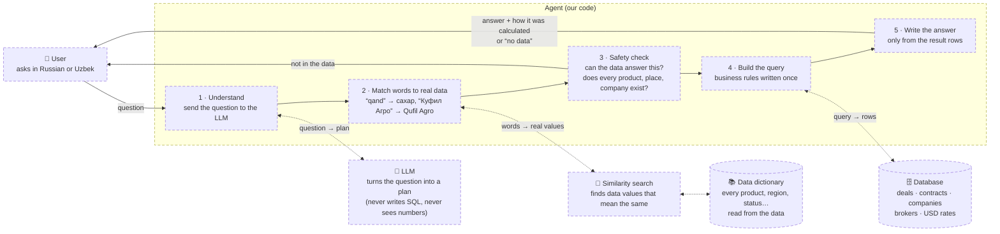
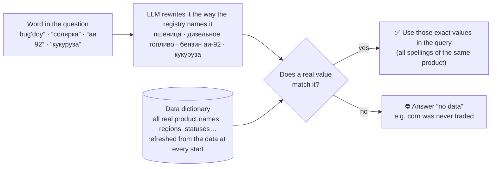

# UZEX trade-registry Q&A agent

Answers questions about exchange deals in **Russian and Uzbek (Latin and Cyrillic)**, only from the provided data.
If the data cannot answer, it says so — it never invents a number, company or product.

## Architecture



| Part | In one sentence |
|---|---|
| **LLM** | Understands the question in any wording and says *what* to compute — it is never trusted with data or numbers. |
| **Data dictionary + similarity search** | Knows every real value in the data, so user words are mapped only to things that actually exist. |
| **Safety check** | If the question is out of scope, or names something that is not in the data, the answer is “no data” — never a guess. |
| **Query builder** | Applies the data rules (volume = lots × lot size, USD → UZS at the deal-day rate, cancelled deals excluded…) the same way every time. |
| **Database** | Holds all 9 CSV files and computes the result. |
| **Answer** | Built from the result rows only, with “understood as …” and the basis, so a judge can check it. |

### How a user's word is matched to the data



- Nothing is hand-written: when the data changes (a new product, region or category), the dictionary changes with it.
- Similarity search is only used to catch different spellings of the **same** thing — never to swap one product for another
  (corn is "similar" to wheat, so it is refused, not mapped).

### The layers

| Layer | File | What it does | Why |
|---|---|---|---|
| Data | `scripts/build_db.py` | Loads all 9 CSVs (5 yearly deal files → one `deals` table; contracts, participants, brokers, USD rates). Builds `deals_enriched` (each deal + its contract card + UZS amount + volume + late flags + price vs start) and `contracts_clean` (typed contract cards). | Formulas computed once; joins checked (500 000 rows in and out, no deal without contract or rate). |
| Understanding | `agent/gemini.py` | The LLM turns the question into a JSON plan. It chooses values only from closed lists (registry names, regions, statuses) and lists every product/place it saw. | Synonyms, nicknames, both Uzbek scripts and typos ("солярка", "qand", "Куфил Агро") — impossible to cover with word lists. |
| Verification | `agent/core.py` | Checks every entity against the database: company names matched across scripts, STIR/broker existence, dates in range, every mentioned product/place resolved. Anything unresolved → "no data". | The disqualification rule: the model may misunderstand, but it can never introduce an entity or number. |
| Semantic layer | `agent/semantic.py` | Metrics (count, amount, volume, prices, stats, distinct, delays, delivered, price change, contract metrics), dimensions (region, seller, buyer, brokers, product, month, category, delivery basis…), filters, one compiler → SQL. | Business rules live in one place: volume = lots × lot size; export amounts converted at the deal-date USD rate; annulled deals excluded from money/volume ("did not happen"); counts show the annulled split. |
| Execution | DuckDB `data/uzex_v2.duckdb` | Runs the SQL (median ~6 ms). | Fast analytical queries on one file, no server. |
| Answer | `agent/semantic.py` `render` | Text built only from result rows, with interpretation, basis and SQL; product breakdown when a product has several registry names; extra metrics for multi-part questions. | Judges see exactly what was computed and can check it. |
| Fallback | `agent/semantic.py` `rule_spec`, `agent/lexicon.py` | Rule parser + closed-vocabulary refusal when the LLM is unavailable. | Keeps answering (more conservatively) without the API. |

### Business rules (README of the data — English translation in [docs/DATA_README_en.md](docs/DATA_README_en.md))
- Prices and start prices are in the **contract currency**: answers show UZS and USD lines separately (6 products trade only in USD);
  "cheapest / most expensive deal" compares UZS-converted unit prices.
- Количество = number of **lots**; volume in units = lots × lot size. Deal numbers have gaps (4,956), so deals are always counted, never `max − min`.
- Statuses are as of the end of 30.10.2026 (stated in answers). Deal time (10:00–17:00, Tashkent) is available as an hour-of-day breakdown.
- Volume = Количество × Лот; unit price = Сумма ÷ (Количество × Лот); never summed across units; kg → t when tonnes are asked.
- Export deals are in USD; UZS = amount × rate on the deal date.
- `Аннулирован(Не оплачен)` = the deal did not happen → excluded from money, volume and prices; deal counts show it separately.
- Late delivery = delivery date > payment date + contract delivery term; late payment = payment date > deal date + payment term.

## Observability: what happens inside a request

Every answer carries a **trace** (`agent/trace.py`), recorded at each stage:

| Step | What is recorded |
|---|---|
| `input` | language, normalised text, mode |
| `rule_entities` | products, regions, STIR, brokers, period found by rules |
| `llm_plan` | model, latency, tokens, the full JSON plan incl. the model's own `analysis` |
| `company_match` | company name as written → normalised key → registry match |
| `verify` | entities kept / dropped, mentioned products & places |
| `refuse` | why the agent said "no data" (which check fired) |
| `spec`, `filters`, `compiled` | metric, grouping, WHERE conditions, query shape |
| `sql` | every SQL statement, row count, DB time, sample rows |
| `answer` | final text, route, confidence, total time |

```bash
# see everything for one question
.venv/bin/python -m agent.inspect "Когда каустическая сода продавалась дороже всего?"
# traced eval run (writes eval/traces/<set>__<mode>__<time>.jsonl)
.venv/bin/python -c "import sys,runpy; sys.path.insert(0,'.'); import agent.core as C; C.MODE='gemini'; sys.argv=['x','eval/bigset7.json','--lenient']; runpy.run_path('eval/run_agent.py', run_name='__main__')"
# failure report: each miss labelled by the stage that broke, with plan, filters and SQL next to the gold
.venv/bin/python eval/report.py eval/traces/<run>.jsonl          # -> eval/reports/<run>.md
# stability: run every question twice, list answers that change
.venv/bin/python eval/stability.py eval/bigset7.json
```

Failure stages used by the report: wrong refusal by the plan · refused by verification · missing grouping / period / product in the plan ·
contract-card feature · wanted a specific deal/date · value differs (definition or compiler) · **FABRICATION**.

## Evaluation (honest numbers)

Questions are written by an independent agent that never sees the code; each set is run **once, unchanged**, before any fixing.

| Set (unseen) | System at the time | Correct | Fabrications |
|---|---|---|---|
| Sets 1–3 | regex templates | 43–67 % | 3–9 per set |
| Sets 4–5 | semantic layer + vocabulary check | 64–72 % | 0 |
| Set 6 | LLM query planner | 72 % | 0 |
| Set 7 (incl. contract-card questions) | + contract fields | 72 % strict / 77 % lenient | 1 → fixed (entity accounting) |
| Set 8 | + value index from data, repair loop | 83 % strict / 85 % lenient | 0 |

Scripts: `eval/run_agent.py <set.json> [--lenient]` (lenient also accepts kg vs t and "2023" vs 2023).

## Run

```bash
uv venv .venv && uv pip install --python .venv/bin/python duckdb rapidfuzz
.venv/bin/python scripts/build_db.py data/extracted/uzex_spot_data data/uzex_v2.duckdb
echo "GEMINI_API_KEY=..." > .env
.venv/bin/python -c "import sys; sys.path.insert(0,'.'); from agent.core import answer; print(answer('сколько сделок по сахару в 2024').text)"
```
