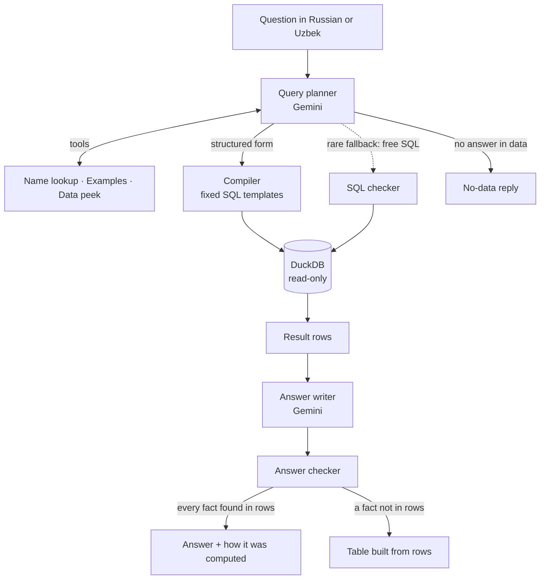
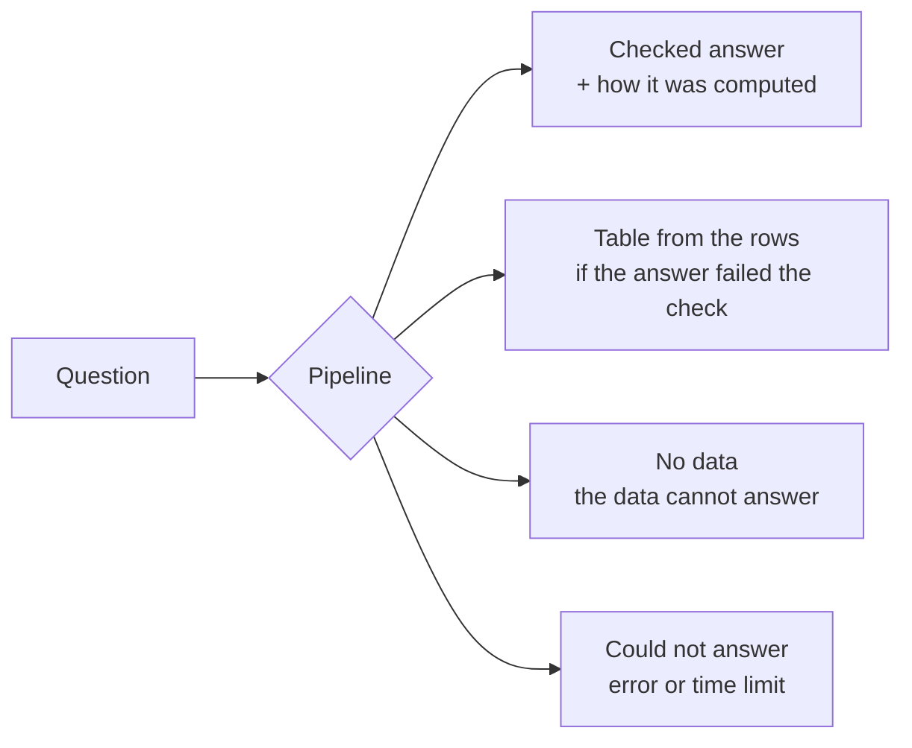

# Exchange Q&A agent

Answers Russian and Uzbek questions about the exchange deal registry in `data/`. Every fact in an answer is
checked against the database result; if the data has no answer, the service says so. The data is fictional:
companies, tax IDs, brokers, contracts, deals and prices are invented (see `data/README.md`).

**Latest evaluation** (60 questions, live Gemini, two runs in a row): 48/48 answerable questions correct,
12/12 unanswerable questions refused, 0 hallucinations, median response 4 s, slowest 12 s (limit 90 s).

## Architecture

The core idea: **the language model never decides the facts.** Gemini only does two language jobs: it turns
the question into a structured query request, and it turns the result rows into a sentence. Everything in
between (finding IDs, building SQL, running it, checking the final answer) is deterministic code.



The two boxes labeled Gemini are the only places a model runs. Everything else is plain Python and SQL.

### The components

| Step | What it does | Code |
|---|---|---|
| Data build | Loads the CSVs once into DuckDB with real types and ready-made columns: tonnes, sums in so'm and USD at the deal-date rate, a "cancelled" flag, and one standard name per product (230 spellings → 42 products). | `app/ingest/` |
| Name lookup | Turns "Pudexiz Plast", "paxta", "Самаркандская область" or "BK001" into the exact IDs stored in the data. Handles Cyrillic ↔ Latin and Russian ↔ Uzbek names. A name that matches nothing returns nothing. | `app/resolve.py` |
| Semantic layer | Column meanings, business rules and the list of known ambiguities, in Russian and Uzbek. Given to the planner in full. | `app/semantic.yaml` |
| Examples | 30+ verified question → query pairs; the closest ones are shown to the planner. | `examples/examples.yaml` |
| Query planner | Gemini with tools. It looks up names, reads examples and fills in a **structured form** (what to count, which filters, how to group). It can also say "the data can't answer this". | `app/agent/writer.py` |
| Form checker | Rejects forms with unknown fields, periods outside the data, IDs that were not looked up or do not exist, or a month/date from the question that is missing in the form. The error goes back to the planner to fix. | `app/compiler/spec.py`, `writer.py` |
| Compiler | Turns the form into SQL from a small set of templates, each tested against hand-written SQL. Also writes one plain sentence saying exactly what was computed. | `app/compiler/sql.py`, `explain.py` |
| Free-SQL checker | Only for questions no form can express. Read-only SELECT, known tables, no name text filters, IDs must be looked up, money must respect currency, no made-up literal rows. | `app/agent/validators.py` |
| Answer writer | Gemini rewrites the result rows as 1–4 sentences in the question's language. | `app/answer/composer.py` |
| Answer checker | Every number, INN, broker code, date and known name in the reply must appear in the result rows or the question. If not, the reply is rewritten once, then replaced by a table built from the rows. | `app/answer/verifier.py` |
| Pipeline and API | Runs the steps under a time budget and serves `POST /ask` plus a chat page. | `app/pipeline.py`, `app/api.py` |

### One question, step by step

*"Сколько сделок было заключено в октябре 2025 года?"*

1. The planner fills the form: count deals, year 2025, month 10.
2. The compiler builds SQL that returns both readings at once: all deals (17 808) and deals without annulled
   ones (16 620).
3. The answer writer says: "В октябре 2025 года заключено 17 808 сделок, без аннулированных — 16 620."
4. The checker confirms both numbers are in the result rows.
5. The code appends: "Расчёт: сделки за 10.2025; все сделки и отдельно без аннулированных."

### What the user can get back



There is no fifth outcome: model text that did not pass the checker never reaches the user.

## Design decisions

### Why a structured form instead of letting the model write SQL

A wrong SQL query gives a wrong number, and the answer checker cannot catch that, because the wrong number
really is in the rows. So most questions go through the form: the model only picks *what* to compute, and
tested templates decide *how*. The model can still make one kind of mistake (choosing the wrong measure or
filter), but that is visible in the form and in the explanation sentence.

### How ambiguous questions are handled

Many questions hide a choice. Instead of guessing, the compiler computes every reasonable reading in one
query and the answer shows them all:

| Ambiguity | Example | What the answer shows |
|---|---|---|
| Deal status | "Сколько сделок…" | All deals and, separately, without annulled ones |
| Measure | "Кто купил больше всего хлопка?" | Top by tonnes and top by value |
| Role | "Кто больше всех торговал?" | Top buyers and top sellers |
| Currency | "Общая сумма…" | So'm by default; USD converted at the deal-date rate when asked |
| Product scope | "хлопок" | Raw cotton by default; the whole cotton group when asked |

Rankings exclude annulled deals, because those deals did not take place.

### How made-up answers are blocked

Each layer closes a different hole:

1. **Names → IDs.** Filters may only use IDs returned by the name lookup or written in the question, and
   the ID must exist in the data. "Брокер BK999" gets "no data", not "0 deals".
2. **Fixed SQL templates.** Most queries are never written by the model.
3. **SQL checker.** The fallback path cannot filter by raw text, invent literal rows, read files or write.
4. **Answer checker.** Every fact in the reply must come from the rows; otherwise a table built from the rows
   is shown instead.
5. **Plain refusals.** Profit, directors, forecasts, other currencies or dates outside 2022–2026 get a
   fixed "no data" reply.

### Time budget

The hard deadline is 75 s, under the 90 s requirement. Each Gemini call is capped at 15 s, and a call only
starts if a full 15 s still fits before its deadline, so the worst case stays near 75 s. In practice most
answers take 3–5 s. A fallback to the second LLM provider (below) counts against the same deadline: it only
starts if a full 15 s still fits.

### LLM providers and fallback

Every model runs the same pipeline (same planner, tools, checks and code-rendered answers); only the
connection differs. Providers are named and tried in the order of `LLM_PROVIDERS`:

```
LLM_PROVIDERS=qwen_local,gemini,openai   # free local model first, paid ones only when it fails
LLM_PROVIDERS=gemini,openai              # default
LLM_PROVIDERS=qwen_local                 # local only
```

Built-in names: `gemini`, `openai`, and `qwen_local` (Ollama at `http://localhost:11434/v1`, model
`qwen2.5-7b-uzex`, temperature 0, tool calls through the prompt). Any other OpenAI-compatible server (vLLM,
llama.cpp, another cloud) gets a name of its own through `<NAME>_TYPE=openai`, `<NAME>_BASE_URL`,
`<NAME>_MODEL`, `<NAME>_API_KEY`, `<NAME>_TEMPERATURE`, `<NAME>_TEXT_TOOLS`; the same variables override the
built-in ones (e.g. `QWEN_LOCAL_MODEL`). A provider is used when it has an API key or a base URL.

If a call fails because of the provider (no credits, bad key, rate limit, server error, connection error, a
blocked/empty reply, or a timeout that still leaves time for another call), the same step is sent to the next
provider in the chain, also in the middle of a planning conversation: the conversation so far (tool calls and
their results) is replayed there, and it continues from there; it never returns to a provider it left. After a
"no credits" / bad-key / forbidden error (HTTP 402, 401, 403) the failing provider is skipped for 5 minutes.
Errors in our own code are never treated as a provider failure. Each answer's `providers_used` shows which
provider wrote each reply; the evaluation takes `--providers` to measure one provider or a chain.

## Project layout

```
app/
  ingest/     CSV → DuckDB build, product dictionary
  compiler/   structured form, SQL templates, explanation sentence
  agent/      Gemini and OpenAI wrappers with fallback, query planner, free-SQL checker
  answer/     answer writer, answer checker, fixed replies
  resolve.py  name lookup
  pipeline.py the full question → answer flow
  api.py      HTTP API; static/ holds the chat page
data/                 source CSVs (fictional)
data_dictionary/      product and region dictionaries
examples/             verified question → query examples
eval/                 60 evaluation questions and the runner
tests/                unit tests (offline) and live tests
```

## Run locally

```bash
uv sync
uv run python -m app.ingest.build
GEMINI_API_KEY=... OPENAI_API_KEY=... uv run uvicorn app.api:app --port 8000
```

Keys can also go into a `.env` file in the project root (`KEY=value` lines; not committed). Variables already
set in the environment win.

Open http://localhost:8000 or call the API:

```bash
curl -s localhost:8000/ask -H 'Content-Type: application/json' -d '{"question": "Сколько сделок было в октябре 2025 года?"}'
```

## Run with Docker

```bash
docker build -t uzex-qa .
docker run -p 8000:8000 -e GEMINI_API_KEY=... -e OPENAI_API_KEY=... uzex-qa
```

## Tests and evaluation

```bash
uv run pytest
GEMINI_API_KEY=... uv run python -m eval.run --workers 2
```

`eval.run` reports SQL correctness, answer correctness, correct refusals, hallucinations (target 0), `hallucinations_vs_gold` (answer numbers/IDs found neither in the gold rows nor in the
returned rows; this catches verifier bypasses) and `answered_wrong` (answers that do not match the gold values) and
latency (limit 90 s), and writes `eval/results/run-*.json`.

## First live run

The tests run offline. Before relying on the service, check it against the real model:

1. `GEMINI_API_KEY=... OPENAI_API_KEY=... uv run pytest -m live` (the live round-trip tests; a provider
   without a key is skipped).
2. Start the server and send one question to `/ask`, for example
   `curl -s localhost:8000/ask -H 'content-type: application/json' -d '{"question":"Сколько сделок было в 2025 году?"}'`.
3. Confirm that the model named in `GEMINI_MODEL` is available for your key (a 404 / "model not found" error
   means it is not); change `GEMINI_MODEL` if needed. `GEMINI_THINKING_BUDGET` must be supported by that model;
   set it to `0` to disable thinking. Do the same for `OPENAI_MODEL`: the default name must be verified for
   your OpenAI account.
4. Then run the full evaluation (`eval.run`); it exits non-zero on any hallucination.

## Settings

| Env | Default | Meaning |
|---|---|---|
| `GEMINI_API_KEY` | none | Gemini key (at least one of the two keys is required) |
| `GEMINI_MODEL` | `gemini-3.5-flash` | model for planning and answer writing |
| `GEMINI_THINKING_BUDGET` | `1024` | thinking tokens per Gemini call |
| `OPENAI_API_KEY` | none | OpenAI key for the fallback model |
| `OPENAI_MODEL` | `gpt-5.4-mini` | fallback model; verify the name is available for your account |
| `OPENAI_REASONING_EFFORT` | empty | sent as `reasoning_effort` to OpenAI; empty = not sent. `gpt-5.4-mini` rejects it together with function tools on Chat Completions, so leave it empty unless your model supports it |
| `LLM_PROVIDERS` | `gemini,openai` | named providers in fallback order (`gemini`, `openai`, `qwen_local`, or your own via `<NAME>_TYPE`) |
| `OPENAI_TEMPERATURE` | empty | temperature for the `openai` provider; empty = not sent |
| `OPENAI_TEXT_TOOLS` | off | `1`: tool calls through the prompt instead of the API tools field (for local servers) |
| `UZEX_DEADLINE_S` | `75` | hard deadline per question |
| `UZEX_LLM_TIMEOUT_S` | `15` | per-call LLM timeout |
| `UZEX_DATA_DIR` | `data` | directory with the source CSV files |
| `UZEX_DB_PATH` | `build/uzex.duckdb` | path of the built DuckDB file |

## Known limitation

The verifier checks numbers, IDs, dates, quoted names and names that exist in the registry. An invented company
or product name that is neither in the registry nor in quotes cannot be detected.
